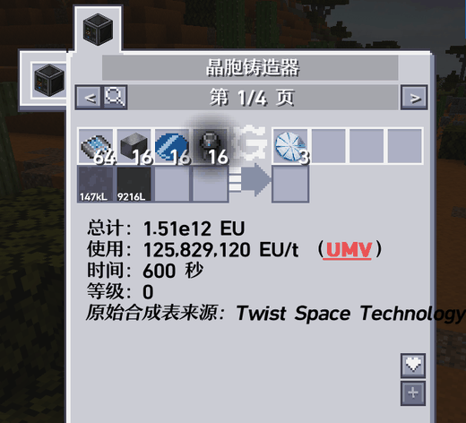
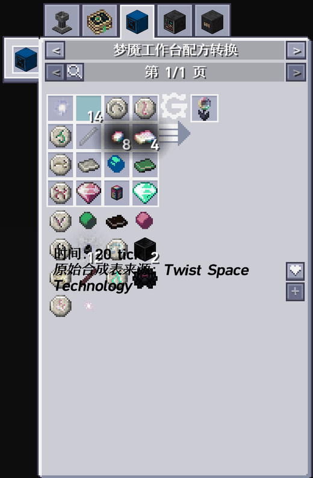
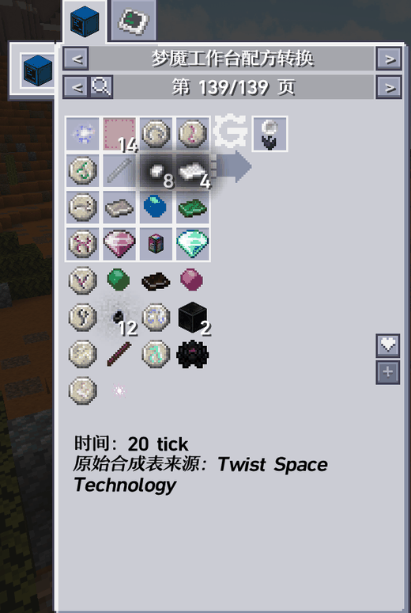

# NEI Recipe Text Wrap

> **本模组使用 AI 制作。**

针对 GT: New Horizons 的 Mixin 补丁，修正 NEI 配方面板的两处文字排版问题：说明行过长不换行、溢出的物品格子压住文字。不修改 GregTech 或 NEI 的任何文件，删除 jar 即完全还原。

## 功能

- **说明行自动换行**：按面板实际宽度（`recipeBackgroundSize.width`）切行，「原始合成表来源：…」这类长文本不再越出边框。
- **文字避让溢出物品**：用该配方表自己的坐标函数算出物品网格真实底边，把「时间 / 来源」整体下移到网格下方。

两者都只在需要时才动作：文字不超宽不动，配方内容未超出面板容量也不动，普通配方外观与原版完全一致。

## 效果对比

**① 来源行越过右边框** —— 例：晶胞铸造器页：



**② 物品压住「时间 / 来源」** —— 例：梦魔工作台配方转换页（TST 配方表，输入格子超出面板容量）：



**修复后** —— 文字下移到网格下方，长来源名折成两行：



两处问题均已消失：来源行在面板宽度内折行，物品不再压住文字。

## 作用范围

修改对象是 `gregtech.nei.RecipeDisplayInfo`，GT 中只有 `GTNEIDefaultHandler` 使用它，因此**所有 GT 配方表**（含 TecTech、Bartworks、GoodGenerator、TST 等附属模组）均生效；原版工作台、Avaritia、神秘时代、AE2 等非 GT 页面不经过该出口，完全不受影响。

## 环境要求

| 项目        | 说明                          |
| --------- | --------------------------- |
| Minecraft | 1.7.10                      |
| 模组包       | GT: New Horizons 2.9.0 正式版  |
| 运行环境      | Java 25                     |
| Mixin 运行时 | +unimixins-all 1.7.10-0.3.1 |
| 其它版本      | 兼容性未知                       |

## 安装

把 `NEI-Recipe-Text-Wrap-<version>.jar` 放入 `.minecraft/mods/` 即可，无配置文件、无依赖声明。

启动后可在 `logs/fml-client-latest.log` 中确认是否生效：

```
Mixing MixinRecipeDisplayInfo from mixins.neiwrap.json into gregtech.nei.RecipeDisplayInfo
```

## 卸载

删除该 jar 即可，不写入存档、配置或缓存。

## 已知限制

- 依赖反射写 `RecipeDisplayInfo.yPos`。若上游改名该字段，**只有文字下沉失效**，换行功能不受影响，客户端不会崩溃。
- 窗口极矮时，文字下移量会被夹取到「屏幕高 − 98 − 30」，此时可能退回「文字贴着最后一行物品」的旧观感，但不会跑到面板外。
- 采用 `required: false` + `require = 0`：注入失败时静默跳过，而不是让客户端崩溃。补丁定位是锦上添花，不应成为启动失败的原因。
- 只移动文字，不改变面板尺寸，也不影响 NEI 的分页与缩放逻辑。

## 实现要点

这两条是 1.7.10 + RFB 环境下最容易出错的地方，改代码时请注意：

1. **MANIFEST 必须带 `TweakClass`**。FML/RFB 只会为带 `TweakClass`（或 `FMLCorePlugin`）的 jar 创建 Mixin 容器，容器建立后才去读 `MixinConfigs`。只有 `MixinConfigs` 而没有 `TweakClass` 时，配置会**静默失效**——日志里连一条错误都没有，只会发现补丁"没反应"。
2. **字节码里必须写 SRG 名**。`Minecraft.getMinecraft()` 要写成 `Minecraft.func_71410_x()`，`fontRenderer` 字段要写成 `field_71466_p`，`getStringWidth` / `listFormattedStringToWidth` 分别是 `func_78256_a` / `func_78271_c`。写 MCP 名不会被重映射，运行时直接 `NoSuchMethodError`。

`stubs/` 就是为第 2 条手写的最小同名同包声明（没有反混淆的 Minecraft jar 可用），仅参与编译，不进最终 jar。

## 许可证

Copyright (c) 2026 cryspera

本项目以 **GNU Lesser General Public License v3.0** 发布，全文见 `LICENSE`。源码文件头均带 `SPDX-License-Identifier: LGPL-3.0-only` 标识。

LGPL-3.0 是对 GPL-3.0 的附加许可，条款正文引用 GPL-3.0，故同时附带 `LICENSE.GPL-3.0` 全文。简言之：可以与闭源模组一起分发，也可以修改后自用；分发修改版时需提供对应源码并保留版权与许可声明。

本模组在运行期通过 Mixin 与 GregTech、NotEnoughItems 交互，但**不包含也不分发**它们的任何代码；`stubs/` 中的同名声明仅为编译所需的空壳，不含上游实现。

---

## English summary

> This mod was produced with AI assistance.

A small Mixin patch for **GregTech 5 Unofficial / GT: New Horizons** that fixes two NEI recipe-page layout issues: long description lines overflowing the panel border (now wrapped to the panel's actual width), and overflowing item slots overlapping the "time / recipe origin" text (text is now shifted below the real grid bottom). It only touches `gregtech.nei.RecipeDisplayInfo`, so it applies to every GT recipe map while leaving non-GT handlers untouched. Tested on GTNH 2.9.0 with Java 25; compatibility with other versions is unknown. No config, no writes to disk; delete the jar to uninstall. Licensed under LGPL-3.0.
